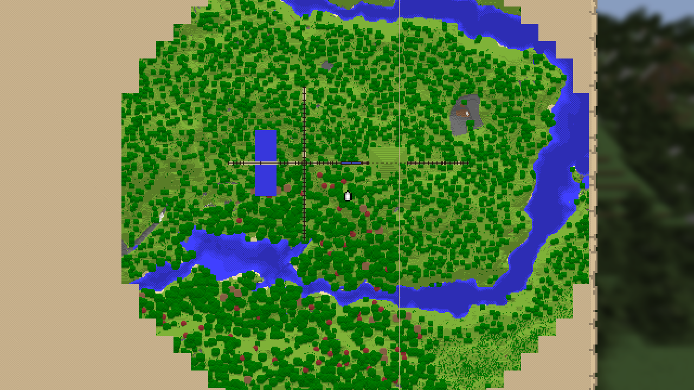
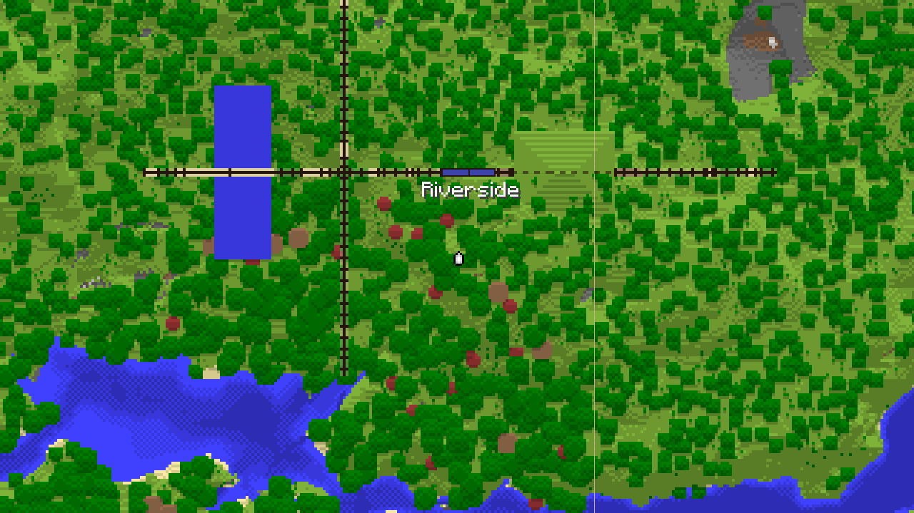
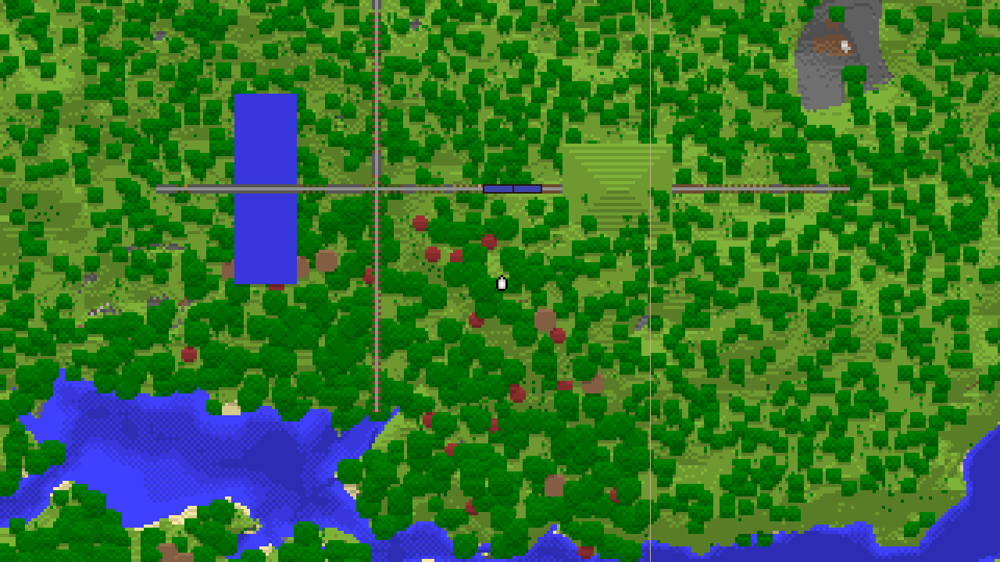

# Immersive Train Lines

Your [Create](https://modrinth.com/mod/create) railways, drawn onto the [Hoofprint](https://modrinth.com/mod/hoofprint) world map and the [Immersive Minimaps](https://modrinth.com/mod/immersive-minimaps) minimap the way a cartographer would have drawn them: in ink, on the paper, and only where the map has actually been.

## Part of the map, not on top of it

- **Pixel for pixel.** Lines are painted one pixel per block in vanilla map colours, the same as the terrain under them. They zoom, pan and pixelate with the map.
- **Charted ground only.** A railway shows up where your map already has ground drawn. Ride a line into the unknown and it gets inked in as the land does.
- **Tunnels and bridges.** Where the line runs under a hill it is drawn dashed; where the ground falls away on both sides it is drawn as a bridge. Switch Hoofprint to cave mode (Tab) to follow a tunnel properly.
- **Stations** are marked on the line. Hover one for its name, or hold Alt to label them all.
- **No GPS.** The map shows a train when you could know where it is: it is near you, you are riding it, or it is standing at a charted station, which is also listed when you hover that station. Out on the line, between stations, it is off the map.
- **Needs a map.** With Immersive Minimaps the minimap only exists while you carry a map, and so do its railways.

## Two ways to draw a line

| Ink (default) | Rails |
| --- | --- |
| The paper-map railway symbol: an ink line with cross-ticks. Tunnels dashed, bridges cased. | The track seen from above: iron rail on wooden sleepers. Tunnels are out of sight until you switch to cave mode. |
|  |  |

## Settings

Mods → Immersive Train Lines → Config, or `config/immersive_train_lines-client.toml`.

| Option | Default | |
| --- | --- | --- |
| `lineStyle` | `INK` | `INK` or `RAILS` |
| `chartedOnly` | `true` | Turn off to reveal every railway on the server |
| `trains` | `REPORTED` | `REPORTED` (near you or at a charted station), `ALL` (every train on charted ground), `NONE` |
| `nearbyRange` | `96` | How close a train must be for you to mark it yourself |
| `stationLabels` | `false` | Always write station names on the world map |
| `minimap` | `true` | Draw on the Immersive Minimaps minimap |

## Requirements

- NeoForge 1.21.1, **client only**; nothing to install on the server beyond Create itself
- [Create](https://modrinth.com/mod/create) 6.0
- [Hoofprint](https://modrinth.com/mod/hoofprint) with [Surveyor](https://modrinth.com/mod/surveyor), running through [Sinytra Connector](https://modrinth.com/mod/connector)
- Optional: [Immersive Minimaps](https://modrinth.com/mod/immersive-minimaps)

Inspired by [Xaero's Train Map](https://modrinth.com/mod/xaero-train-map). No code or assets from it, Create, Hoofprint or Immersive Minimaps are included.
